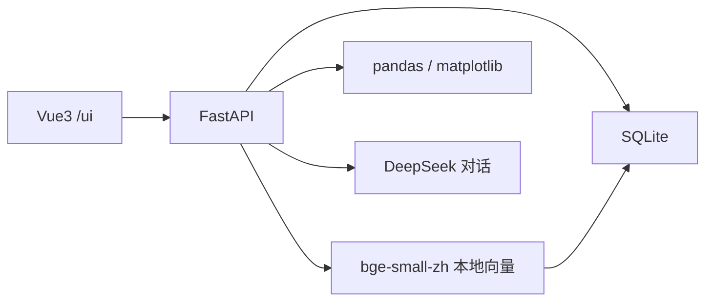

# 求职材料（第 22 课）

求职意向：AI 应用开发 / Python 后端（大模型应用）。

联系方式沿用介绍页 https://intro.rochsen.cn/ ，电话和出生年月不写进这个仓库。

下面的公司和项目事实来自 2022–2025 工作总结。LabAssist 是这门课做的个人项目，不是公司上线系统。

## 简历

罗浩森

广州序源医学科技有限公司 · 生物信息分析工程师 · 2022.06–2026.01

仲恺农业工程学院 · 种子科学与工程

个人项目用 FastAPI 做了实验室文档与质控助手 LabAssist：登录后的数据按用户隔离；质控数字由 pandas 计算，模型只写结论；SOP 回答必须带原文，资料里没有就回答「不知道」；同一套 20 道题可以复跑命中率。前端是 Vue3，服务可以用 Docker Compose 启动。

### LabAssist（个人项目）

- 批次、用户、对话、文档切块、评测和质控图存在 SQLite。注册登录用 JWT，未登录返回 401，用户只能看自己的记录。
- 文档按 60 字切块、重叠 15 字，用本地模型 bge-small-zh-v1.5 做向量，相似度在 Python 里算。分数低于 0.5 不调用模型，直接回答「不知道」。
- 20 道自写题目、按标题是否进入前 3 名，命中率 1.0。把切块改成 8 字、不重叠后，只看第 1 名时命中率降到 0.95，前后两次数字都留着。
- 问到质控数字时，服务端用 pandas 算均值和异常个数，模型只根据这些数字写中文。上传 CSV 后由 matplotlib 画图，结论里的数字同样来自 pandas。
- 页面用 SSE 先给出引用，再逐段显示回答。`docker compose up --build` 后可以完成登录和提问。模型接口是 DeepSeek 的 OpenAI 兼容 API。

### 工作经历里和这个方向有关的部分

WES / ECS 分析流程

- 用 Snakemake 把 Fastp、BWA、GATK、DeepVariant、VEP 收成可重复的流程，并完成 hg19 生产迁移和 hg38 转换测试。
- 注释从大约 6 小时降到大约 2 小时。Picard 标记重复约 40 分钟，换成 Sambamba 后约 4 分钟，位点一致性 99%。
- 用同一批样本对比 DeepVariant 和 GATK、VEP 和 ANNOVAR，按速度、位点一致性和致病位点数量决定换不换，不凭单个工具的宣传替换。

PGS 质控报告软件

- 按月份、单位、销售组合统计并出图，打包成软件。覆盖实验室 60% 以上的数据整理和报告需求。
- 软著：《基于生物医疗的数据统计绘图及报告生成软件》（2024SR1361364）。
- 另有《适用于全外显子基因检测的信息分析软件》（2024SR1686921）、《临床检验信息管理系统》（2025SR1054906）。

常规临检系统 CIP 前端

- 2024 年 10 月开始用 Vue3 做 CIP。到当年年底，124 个需求里完成 53 个。
- 2025 年并行维护双子星版、序源版、商业版和宣传网站，配套文档从 V1.2.0 维护到 V1.9.x。2025 年 4 月生产版本到 V1.7.0，10 月这段前端告一段落。
- 技术是 Vue3、TypeScript、Ant Design Vue、Vben Admin。文件管理和测序平台前端是同一阶段的交付，不单独展开。

### 技能

Python、FastAPI、Pydantic、SQLite、JWT、pandas、matplotlib、pytest。Vue3、TypeScript、SSE。本地向量模型 fastembed，OpenAI 兼容的对话接口，Docker Compose。生信流程：Snakemake、Fastp、BWA、GATK、DeepVariant、VEP、ANNOVAR。

## 三个故事

每个故事按「当时要解决什么、比较了什么、用什么数字做决定、结果是什么」来讲，控制在两分钟内。

### 1. WES：换注释引擎和标记重复工具

2023 年注释要跑大约 6 小时，占全流程一半以上。先把注释改成多进程，降到大约 2 小时，上午分析、下午可以出结果。

标记重复原来用 Picard，大约 40 分钟，而且占满 CPU，别的项目排不上。对比了 Sambamba（约 4 分钟）、GATK Spark（约 9 分钟）和原来的 Picard。Sambamba 标记后的位点一致性是 99%，又能限制线程，所以换它，不是因为它名字新。

2024 年再评估两件更大的替换。DeepVariant 和 HaplotypeCaller 比速度、原始位点、注释结果和致病评级。DeepVariant 4 线程大约 3 到 4 小时，HaplotypeCaller 大约 2.5 小时；位点一致性不高，但 RefCall 能多拿到一批 ClinVar 致病位点，所以当时的结论是可以接纳，不是立刻全量替换。VEP 替换 ANNOVAR 是因为 ANNOVAR 会丢掉 0/0 基因型。替换后自己做了 Consequence 到严重性分值的映射，把 PP3/BP4 字段留住，再用旧结果对比：排序靠前的 30% 到 40% 一致性可以接受，P/LP/VUS 数量没有明显差距，才确认换上。

BWA 和 SNAP 也比过，没有收益就不换。

### 2. CIP：从零做临检前端并交到生产

2024 年 10 月才开始写 Vue3。CIP 是给检测机构实验员用的，要填送检单、管样本和项目。我负责引物标签、样本信息、任务投递、参数管理这些页面，技术栈是 Vue3、TypeScript、Ant Design Vue、Vben Admin。到 2024 年底，124 个需求里我完成 53 个。

2025 年不是重写一个演示页，而是同一套系统的多个版本一起维护：双子星版的仪器管理和分类导出，序源版的字典和签发审批，商业版的管理面板，再加上 VitePress 宣传站和授权下载。说明文档跟着生产版本从 V1.2.0 写到 V1.9.x。2025 年 4 月生产版本更新到 V1.7.0，10 月 CIP 前端告一段落。软著材料里的使用说明和源程序页也是这次一起准备的。

这个故事要说明的是：前端可以独立交到生产，LabAssist 的聊天页用的是同一套 Vue3，而不是临时学的另一门框架。

### 3. LabAssist：数字和原文都不让模型编

作品分四块。批次 API 在登录之后只能操作自己的记录，并能导入 CSV。质控图和均值、异常个数由 pandas 计算，模型只把这三个数写成一句中文。知识库回答必须引用切块原文，相似度不够就回答「不知道」，并且不调用模型。问到数据库里的数字时，模型只负责选出工具，计算在服务端做完，再把结果送回去写句子。

评测用 10 段自己写的 SOP 和 20 道标好标题的题。切块 60 字、重叠 15 字时，第 1 名标题全对，命中率 1.0。改成 8 字、不重叠后再测，第 1 名命中率 0.95。上传文档的切块没有跟着改，仍然是 60 和 15。页面用 SSE 显示引用和回答，Docker Compose 能把页面和接口一起启动。

## 架构

浏览器打开 `/ui`。登录拿到 JWT，之后每个请求都带这个 token。

提问走 `POST /answers/stream`。服务用和入库相同的方式把问题嵌入，和当前用户的切块做余弦相似度，取得分最高的 3 段。有达到 0.5 的切块时，先发 `citations` 事件，再让 DeepSeek 只根据这些原文生成回答，用 `delta` 事件推到页面。没有达到 0.5 的切块时，只发一段「不知道」，不请求模型。

质控走 `POST /qc-charts`。CSV 先由 pandas 算出均值和异常个数，matplotlib 画图，模型只能用这三个数字写一句话。问历史批次或请模型「算一下」时，也是服务端查库、用 pandas 计算，模型不自己算。

数据在 SQLite：用户、批次、消息、文档、切块（向量以 JSON 存放）、评测记录、质控图。没有单独的向量数据库。Docker 镜像里是构建好的页面和 Python 接口，密钥在启动时从 `.env` 读入。

## 检索失败时怎么改

先分清两种失败。

资料里本来没有这个问题。例如空库里问「实验室食堂几点开门」。相似度到不了 0.5，接口返回「不知道」，citations 为空。这时不要去调模型，也不要降低 0.5。要补的是文档：写进对应 SOP，重新切块、重新嵌入，再用原来的 20 题加上这道新题跑一遍。

资料里有，但拿错了段落。第 18 课就是这种。切块改成 8 字、不重叠之后，20 题里有 19 题的第 1 名标题仍然正确。错的一题是「样本溅到台面上怎么处理」，应引用「生物安全」，实际第 1 名是「样本接收」，两边分数大约 0.661 和 0.660。前 3 名里正确标题还在，所以如果命中定义放宽到前 3 名，这组切块仍然是 20/20。生产入库保持 60 字、重叠 15 字，就是因为更短的切块让正确段落和第 1 名错开了。

对应的改法按这个顺序：

1. 用同一批 20 题复跑，同时记下第 1 名命中率和前 3 名命中率。只看一个总数会把「找错第 1 名」和「根本没找到」混在一起。
2. 正确标题还在前 3 名、只是没排到第 1 时，先把切块加长并恢复重叠，而不是改提示词。提示词改变不了谁排第一。
3. 两段分数贴得很近时，检查切块边界有没有把操作步骤切碎，以及两份 SOP 是不是都在说「样本」。把生物安全那几句保持在同一块里。
4. 正确标题不在前 3 名，或最高分低于 0.5 时，先补原文或改切分，再考虑阈值。阈值只决定「没有依据时拒答」，不能用来把错段落说成对的。
5. 每次改动都留下前后两次的 total、hit_count、hit_rate。第 18 课留下的就是 1.0 和 0.95。
